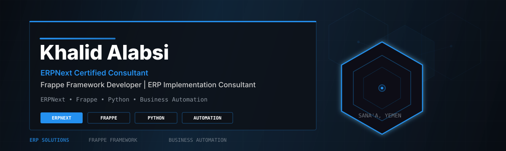

  

<h1 align="center">Khalid Alabsi</h1>

  <strong>Frappe Framework Developer | ERPNext Developer</strong> 
  <em>Building practical ERP solutions, custom applications, and business workflows with Frappe and ERPNext.</em>

  
  
  

  

---

## About Me

I'm a **Frappe Framework and ERPNext developer** focused on building and customizing ERP systems around real business processes.

My work involves turning business requirements into practical ERP solutions using custom applications, DocTypes, workflows, permissions, reports, print formats, integrations, and automation.

I enjoy working close to both the **business process and the code** — understanding how a company operates, then building the system around that process.

---

## What I Work With

<table>
  <tr>
    <td width="50%" valign="top">

### ERPNext & Frappe

- Custom Frappe Applications
- Custom DocTypes
- Child Tables
- Workflows
- Permissions
- Client Scripts
- Server-side Python
- Reports
- Print Formats
- Notifications
- Hooks
- REST API

    </td>
    <td width="50%" valign="top">

### Development

- Python
- JavaScript
- SQL
- MariaDB
- Linux
- Git
- Docker
- Frappe Bench
- REST APIs
- GitHub

    </td>
  </tr>
</table>

---

## Featured Projects

### 🔬 Histopathology Laboratory ERP

A customized **ERPNext/Frappe system for histopathology laboratory operations**.

The project focuses on building a complete operational workflow around laboratory visits, samples, diagnosis, billing, commissions, and reporting.

**Key areas:**

- Laboratory Visit management
- Accession and sample processing
- Laboratory workflow automation
- Diagnosis workflow
- Referral doctor management
- Commission and payment logic
- Role-based permissions
- Reports
- Custom print formats
- QR/barcode workflows
- ERPNext accounting integration

**Stack:** `Frappe` `ERPNext` `Python` `JavaScript` `MariaDB`

---

### 🚗 Automotive Spare Parts ERP

An **ERPNext implementation and customization project** for an automotive spare-parts business.

The system covers the main business operations from purchasing and inventory to sales and accounting.

**Key areas:**

- Item and inventory management
- Buying
- Selling
- Stock management
- Price lists
- Customer management
- Accounting configuration
- Business process configuration
- User permissions

**Stack:** `ERPNext` `Frappe` `Python` `Linux`

---

### 🧩 Frappe ERP Toolkit

A collection of reusable patterns and experiments for building ERPNext and Frappe applications.

The goal is to develop reusable approaches for common ERP requirements rather than solving every project from scratch.

**Areas of focus:**

- Workflow patterns
- Permission systems
- Reports
- Notifications
- API integrations
- Custom DocTypes
- Business process automation
- Deployment

**Stack:** `Frappe` `ERPNext` `Python` `JavaScript`

---

## Technical Stack

  
  
  
  
  
  
  
  
  
  
  

---

## Currently Learning

I'm continuously improving my understanding of the infrastructure and engineering side of Frappe applications.

- Docker & containerization
- Frappe deployment
- REST API development
- Frappe internals
- Application architecture
- Production deployment
- System integration

---

## Development Approach

> Understand the business process first. Then build the software around it.

I prefer building ERP systems that are **simple, maintainable, and aligned with how people actually work**.

Instead of adding customization for the sake of customization, I focus on understanding the underlying process and using Frappe/ERPNext to make that process more reliable and efficient.

---

## GitHub

  
  

---

  

  <strong>Building practical ERP solutions with Frappe and ERPNext.</strong>

